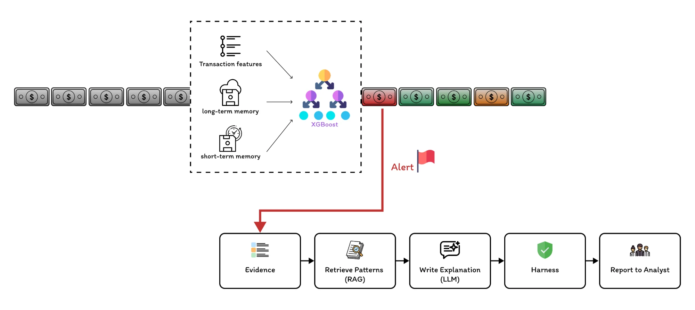
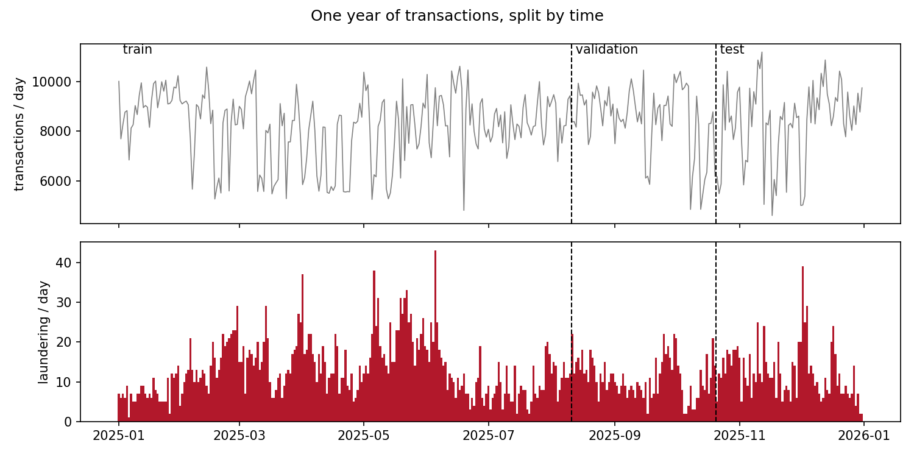
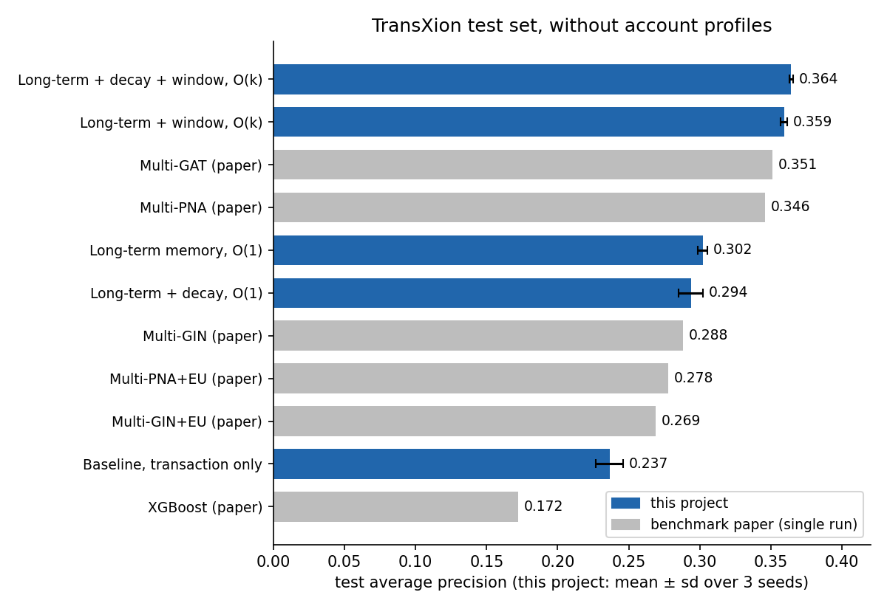

# Memory-Efficient Money-Laundering Detection and Explanations

Detecting money laundering with a small, fixed memory per account, and explaining each
alert to an analyst.

## Abstract

**Question: how far can simple per-account statistics go in detecting money laundering?**

Several published money-laundering detectors build a graph of all accounts and
transactions, which grows with every payment. This project tests a simpler alternative on
one benchmark: a **small, fixed memory per account**. Each account keeps a few running
numbers about its past and, optionally, its last 20 transactions; the memory is read
before each transaction and updated after it, and its size does not grow with the
account's history.

On the TransXion benchmark (test set, 3 seeds), **a constant-size long-term memory raised
average precision from 0.237 to 0.302** over the same model without memory, and **adding
the last 20 transactions raised it to 0.364**. On this benchmark, that is **close to two
graph neural networks reported in the benchmark paper**, Multi-GAT (0.351) and Multi-PNA
(0.346). The comparison is approximate (see below), and these results have not been
tested on other datasets.

Each alert then goes through an explanation layer:



The alert's facts are collected into a small evidence pack, 3 matching known
laundering patterns are retrieved (RAG), an explainer writes a short explanation citing
them, and 10 automatic checks test it. With the offline (rule-based) explainer, all 16
test alerts passed all 10 checks, and each check was shown to catch a deliberately broken
explainer.

## Data and Benchmark

**TransXion** ([Chen et al., KDD 2026](https://arxiv.org/abs/2604.17420)) is a synthetic
anti-money-laundering benchmark: one year of bank transfers between accounts, each
labelled as laundering or not.

| | |
|---|---|
| Transactions | 3,029,170 |
| Accounts | 47,526 (46,400 people, 1,330 merchants) |
| Laundering | 4,641 (0.15%) |
| Period | 2025-01-01 to 2025-12-31 |

The paper compares tree models (XGBoost, LightGBM), which look at each transaction alone,
with graph neural networks (GNNs), which learn from the whole transaction graph. The GNNs
score much higher, which suggests that an account's past matters.

As in the paper, the data is split by time, 60/20/20: models learn from the first 60% of
the year, choices are made on the next 20% (validation), and the last 20% (test) is
used once at the end.



**Metric.** With 0.15% positives, ROC AUC is close to 1 for every model and does not
separate them. The main metric is **average precision** (AP): how high the real laundering
cases sit in the ranked list. A random ranking scores 0.0015.

## Method

A GNN uses each account's neighbours and their neighbours, but needs the whole graph. The
question here is the opposite one: **what if each account only remembers a little about
its own past?**

### Memory per account

The memory has two parts: what the account is like **in general**, and what it has been
doing **lately**. For the second part there are two common ways, and comparing them is
part of the question.

| Part | How | Keeps | Memory per account |
|---|---|---|---|
| **Long-term** | running statistics over all history | count, mean, variance, share incoming, time since last, a 64-slot count of counterparties | O(1) |
| **Recent, by decay** | old transactions fade gradually | two exponential moving averages | O(1) |
| **Recent, by window** | keep the last k = 20 exactly | the last 5 and 20 transactions | O(k) |

None of the parts grows with the number of transactions an account has made. In the
measured run, an account with 5,413 transactions used the same memory as any other.

### Pipeline

The figure in the Abstract shows the pipeline. After scoring, both accounts' memories are updated with the transaction. The features
read from the memory are listed in [Appendix A](#appendix-a-features).

**Why read before write.** Each transaction's features come from the memory as it stood
before that transaction; reversing the two would let a transaction see itself.
`scripts/check.py` confirms this by rebuilding 200 random accounts from a full rescan of
their past and comparing.

**Why XGBoost.** It is the paper's own tree baseline, so the only difference between the
baseline and the memory models is the memory. Every model uses the same fixed settings,
with no tuning.

## Results

Validation: one run (seed 42). Test: mean ± standard deviation over 3 seeds.

| Model | Source | Memory per account | Valid AP | Test AP | Test precision@100 |
|---|---|---|---|---|---|
| Baseline: the transaction alone | this project | none | 0.245 | 0.237 ± 0.010 | 0.310 |
| + long-term | this project | O(1) | 0.346 | 0.302 ± 0.003 | 0.417 |
| + long-term + decay | this project | O(1) | 0.334 | 0.294 ± 0.009 | 0.403 |
| + long-term + window | this project | O(k) | 0.383 | 0.359 ± 0.003 | 0.463 |
| **+ long-term + decay + window** | this project | O(k) | 0.380 | **0.364 ± 0.001** | **0.497** |
| XGBoost | paper | none | – | 0.172 | – |
| Multi-GIN | paper | whole graph | – | 0.288 | – |
| Multi-GIN+EU | paper | whole graph | – | 0.269 | – |
| Multi-PNA | paper | whole graph | – | 0.346 | – |
| Multi-PNA+EU | paper | whole graph | – | 0.278 | – |
| Multi-GAT | paper | whole graph | – | 0.351 | – |

Precision@100: the share of laundering among the 100 test transactions with the top scores.
The same table is in [`docs/results/summary.csv`](docs/results/summary.csv).

**About the paper's numbers.** They come from the paper's Tables 2 and 3. Both sides use
the same data and a 60/20/20 split by time, but some differences remain, so the
comparison is approximate:

- **Split boundary.** This project cuts by row count after sorting by time, so
  transactions sharing a timestamp at a boundary can fall on either side. The paper
  splits "by timestamp" without further detail.
- **Features and settings.** The paper does not publish its exact input features or
  model settings.
- **Runs.** The paper reports single values; this project reports the mean of 3 seeds.



**Account profiles** (age, occupation, industry ...) were also tested:

| Model | Valid AP | Test AP |
|---|---|---|
| Baseline | 0.245 | 0.237 |
| Baseline + profile | 0.247 | 0.237 |
| Long-term + decay | 0.334 | 0.294 |
| Long-term + decay + profile | 0.344 | 0.299 |
| Long-term + decay + window | 0.380 | 0.364 |
| Long-term + decay + window + profile | 0.391 | 0.364 |

Gender is left out as a protected attribute.

## Discussion

**An account's own past carries much of the signal.** A fixed set of running statistics
per account raises test AP from 0.237 to 0.302, and the share of laundering among the top
100 alerts from 0.310 to 0.417.

**Keeping recent transactions helped; decaying averages did not.** On test, the decaying
averages did not improve on the long-term part (0.294 against 0.302, within the seed
spread). The window of the last 20 transactions added about 0.06. A possible reason: an
average describes how much an account sends, while the window also shows how fast it is
acting and with how many different counterparties.

**A small memory came close to the graph models.** With all three parts, test AP is
0.364, close to Multi-GAT (0.351) and Multi-PNA (0.346) without profiles in the paper, and
below Multi-PNA with profiles (0.375). The comparison is approximate (see above), and the GNNs
use information this memory does not have, such as neighbours of neighbours.

**Profiles changed little once behaviour was known.** On test, adding age, occupation or
industry changed AP by less than the seed-to-seed spread, with or without memory.

## Explanation Layer

A score alone does not tell an analyst why a transaction looks suspicious. `src/alerts/`
turns each alert into a short explanation:

| Step | What it does |
|---|---|
| Evidence | a small JSON of the alert's facts, the accounts' recent transactions, and their earlier flagged ones; the explainer sees only this |
| Retrieve | 3 matching entries from a small corpus of common laundering patterns (TF-IDF similarity) |
| Explain | an LLM (`--backend claude`) or an offline rule-based version writes a summary citing those patterns |
| Check | 10 automatic checks on every explanation |

The checks catch, among others, numbers not in the evidence pack, citations of patterns
that were not retrieved, verdicts instead of descriptions, and reasoning from protected
attributes. Each check is tested with a deliberately broken explainer, to show it can fail.

Results on the full data, **offline explainer**, 16 test alerts (4 with no history on
either side):

| Test | Result |
|---|---|
| explanations passing all 10 checks | 16 / 16 |
| broken explainers caught by their check | 10 / 10 |
| prompt-injection attempts that changed the explanation | 0 / 9 |
| tool-limit tests holding | 5 / 5 |

The offline explainer never reads the free-text field, so the injection test only becomes
a real test with an LLM. All result files are in [`docs/results/`](docs/results/).

## Limitations

- **A shortcut in the data.** In TransXion, the amount paid equals the amount received for
  100% of laundering transactions but only 8.4% of clean ones, a property of the
  simulator rather than of laundering. On validation, a transaction-only model scores AP
  0.002 without the received-side fields and 0.245 with them. This was noticed, but the
  main results keep these fields to follow the paper's setup and stay comparable with it,
  so part of every model's score may come from this shortcut. A `clean` protocol without
  them is included in the code.
- One benchmark only, and it is synthetic; the labels are the benchmark's ground truth.
  The results may not hold on other data.
- No tuning: every model uses the same fixed settings.
- The window part was added back after a first test run had shown the decay memory alone.
- The explanation layer was tested only with the offline explainer.
- The pattern corpus is a short summary of common typologies, not quoted from an official
  source.

An alert is a reason to look, never a finding about any person.

## Usage

Put TransXion's `tx.csv`, `person.csv` and `merchant.csv` in `data/raw/`, then:

```
python -m scripts.check                          sanity checks
python -m scripts.train paper memory windows     one model, on validation (see train.py)
python -m scripts.final                          test set, run once
python -m scripts.summary                        validation for all models + summary table
python -m scripts.figures                        figures for this page
python -m scripts.harness                        explanation layer, offline
```

## Appendix A: Features

Every memory feature exists for the sender (`sender_...`) and the receiver
(`receiver_...`). Names as in `src/features.py`.

| Name | Part | Meaning |
|---|---|---|
| `count` | long-term | transactions before this one |
| `mean_amount` | long-term | the account's usual amount |
| `amount_to_mean` | long-term | this amount ÷ usual amount (96 = 96 times usual) |
| `std_amount` | long-term | how much its amounts usually vary |
| `amount_z` | long-term | how unusual this amount is for the account |
| `log_seconds_since_last` | long-term | time since its previous transaction |
| `incoming_fraction` | long-term | share of its transactions that were incoming |
| `counterparty_frequency` | long-term | past transactions with this counterparty (0 = first time) |
| `distinct_counterparties` | long-term | number of different counterparties |
| `counterparty_entropy` | long-term | many counterparties equally, or a few mostly |
| `ema_fast`, `ema_slow` | decay | recent averages, fading quickly and slowly |
| `fast_to_slow` | decay | spending rising lately |
| `r5_...`, `r20_...` | window | count, mean, spread, ratio, distinct counterparties, outgoing share and time span over the last 5 and 20 transactions |
| `sender_receiver_similarity` | long-term | do the two accounts deal with the same circle? |

The transaction's own fields (amount, time, banks, payment format, currencies) are the
baseline's 13 columns.
